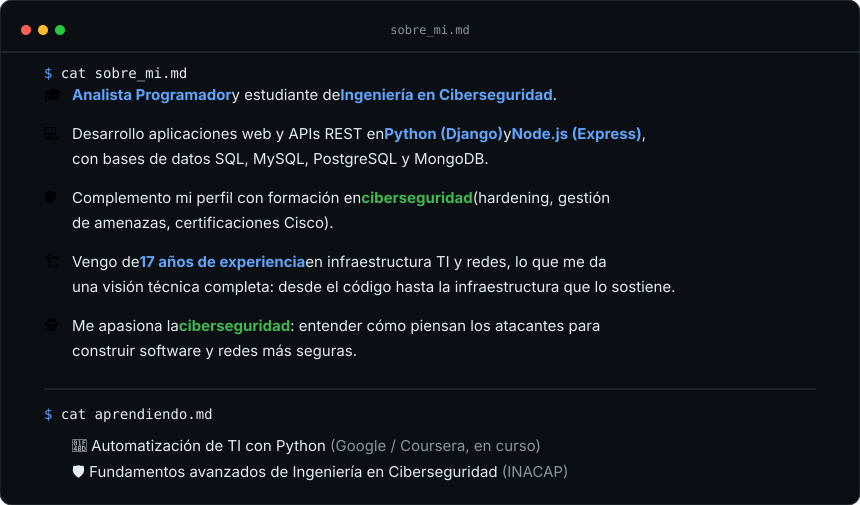
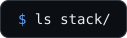
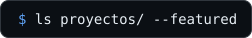
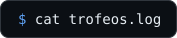
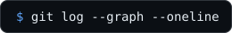
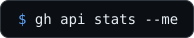
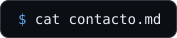

 

 

- **[nieve-y-sol](https://github.com/MauExpl01t/nieve-y-sol)** — Sistema de reservas, API REST en Node.js/Express + PostgreSQL con login, roles y seguridad (proyecto en equipo, Scrum Master).
- **[webscan](https://github.com/MauExpl01t/webscan)** — Herramienta de diagnóstico de seguridad web en Python (checks OWASP, pruebas activas opt-in, 29 pruebas automatizadas).

 

 

 

 

